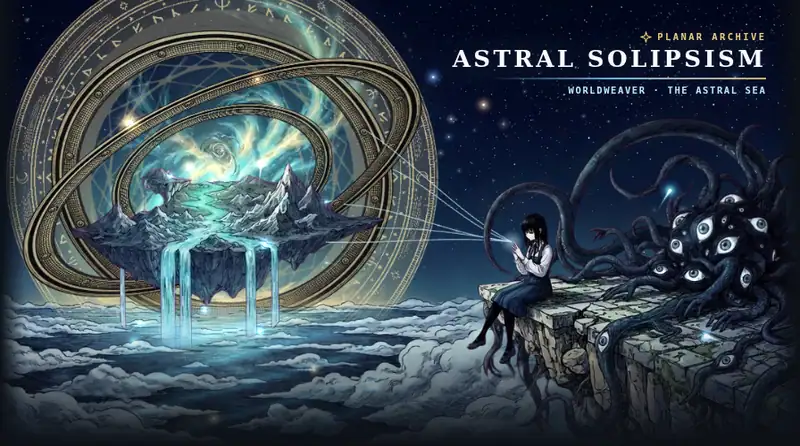
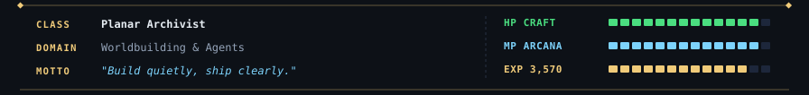
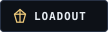
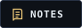
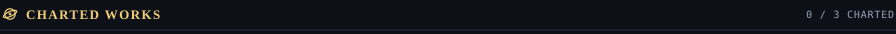
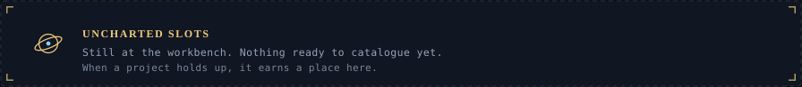
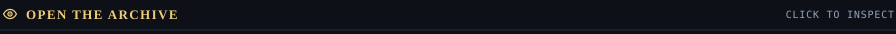
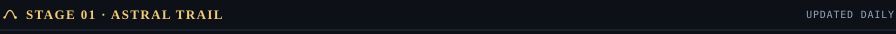
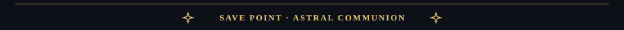
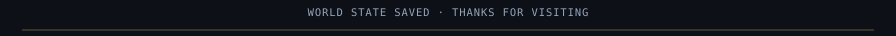

  <picture>
    <source media="(prefers-color-scheme: dark)" srcset="assets/hero-dark.webp" />
    <source media="(prefers-color-scheme: light)" srcset="assets/hero-light.webp" />
    
  </picture> <picture>
    <source media="(prefers-color-scheme: dark)" srcset="assets/status-dark.svg" />
    <source media="(prefers-color-scheme: light)" srcset="assets/status-light.svg" />
    
  </picture>

  <a href="#user-content-realms">
    <picture>
      <source media="(prefers-color-scheme: dark)" srcset="assets/ui/nav-realms-dark.svg" />
      <source media="(prefers-color-scheme: light)" srcset="assets/ui/nav-realms-light.svg" />
      
    </picture>
  </a>&nbsp;
  <a href="#user-content-artifacts">
    <picture>
      <source media="(prefers-color-scheme: dark)" srcset="assets/ui/nav-artifacts-dark.svg" />
      <source media="(prefers-color-scheme: light)" srcset="assets/ui/nav-artifacts-light.svg" />
      
    </picture>
  </a>&nbsp;
  <a href="#user-content-chronicle">
    <picture>
      <source media="(prefers-color-scheme: dark)" srcset="assets/ui/nav-chronicle-dark.svg" />
      <source media="(prefers-color-scheme: light)" srcset="assets/ui/nav-chronicle-light.svg" />
      
    </picture>
  </a>&nbsp;
  <a href="#user-content-trail">
    <picture>
      <source media="(prefers-color-scheme: dark)" srcset="assets/ui/nav-trail-dark.svg" />
      <source media="(prefers-color-scheme: light)" srcset="assets/ui/nav-trail-light.svg" />
      
    </picture>
  </a>&nbsp;
  <a href="#user-content-contact">
    <picture>
      <source media="(prefers-color-scheme: dark)" srcset="assets/ui/nav-contact-dark.svg" />
      <source media="(prefers-color-scheme: light)" srcset="assets/ui/nav-contact-light.svg" />
      
    </picture>
  </a>

  <picture>
    <source media="(prefers-color-scheme: dark)" srcset="assets/ui/sec-realms-dark.svg" />
    <source media="(prefers-color-scheme: light)" srcset="assets/ui/sec-realms-light.svg" />
    
  </picture>

  <picture>
    <source media="(prefers-color-scheme: dark)" srcset="assets/ui/realms-reserved-dark.svg" />
    <source media="(prefers-color-scheme: light)" srcset="assets/ui/realms-reserved-light.svg" />
    
  </picture>

<!--
  EMPTY SLOT FOR FEATURED PROJECTS
  When a project is ready to show, replace the empty-slot banner above with a table:

  | Project | Focus | Status |
  | :--- | :--- | :--- |
  | **[Project Name](https://github.com/AstralSolipsism/repo)** | One-line summary | `ACTIVE` |
-->

  <picture>
    <source media="(prefers-color-scheme: dark)" srcset="assets/ui/sec-explore-dark.svg" />
    <source media="(prefers-color-scheme: light)" srcset="assets/ui/sec-explore-light.svg" />
    
  </picture>

<picture><source media="(prefers-color-scheme: dark)" srcset="assets/ui/ico-artifact-dark.svg" /><source media="(prefers-color-scheme: light)" srcset="assets/ui/ico-artifact-light.svg" /></picture>&nbsp; <strong>[ ARTIFACTS ]</strong> — Tools of the Trade

| Discipline | Kit |
| :--- | :--- |
| **TONGUES** | `Python` &nbsp; `TypeScript` &nbsp; `Rust` &nbsp; `Go` &nbsp; `Vue` |
| **AUTOMATA** | `Autonomous Agents` &nbsp; `Memory Systems` &nbsp; `MCP` |
| **CRAFT** | `System Architecture` &nbsp; `Automation` &nbsp; `Developer Experience` |

<picture><source media="(prefers-color-scheme: dark)" srcset="assets/ui/ico-chronicle-dark.svg" /><source media="(prefers-color-scheme: light)" srcset="assets/ui/ico-chronicle-light.svg" /></picture>&nbsp; <strong>[ CODEX ]</strong> — Margin Notes

Mostly tinkering with AI tooling and small systems that run on their own. Still learning the craft.

  <picture>
    <source media="(prefers-color-scheme: dark)" srcset="assets/ui/sec-trail-dark.svg" />
    <source media="(prefers-color-scheme: light)" srcset="assets/ui/sec-trail-light.svg" />
    
  </picture>

  <picture>
    <source media="(prefers-color-scheme: dark)" srcset="https://raw.githubusercontent.com/AstralSolipsism/AstralSolipsism/output/github-contribution-grid-snake-dark.svg" />
    <source media="(prefers-color-scheme: light)" srcset="https://raw.githubusercontent.com/AstralSolipsism/AstralSolipsism/output/github-contribution-grid-snake.svg" />
    
  </picture>

  <picture>
    <source media="(prefers-color-scheme: dark)" srcset="assets/ui/savepoint-header-dark.svg" />
    <source media="(prefers-color-scheme: light)" srcset="assets/ui/savepoint-header-light.svg" />
    
  </picture> 
  <a href="mailto:astralsolipsism@outlune.com">
    <picture>
      <source media="(prefers-color-scheme: dark)" srcset="assets/ui/btn-contact-dark.svg" />
      <source media="(prefers-color-scheme: light)" srcset="assets/ui/btn-contact-light.svg" />
      
    </picture>
  </a> 
  <picture>
    <source media="(prefers-color-scheme: dark)" srcset="assets/ui/savepoint-footer-dark.svg" />
    <source media="(prefers-color-scheme: light)" srcset="assets/ui/savepoint-footer-light.svg" />
    
  </picture>

